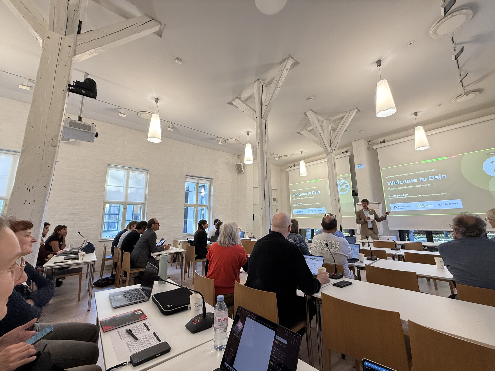
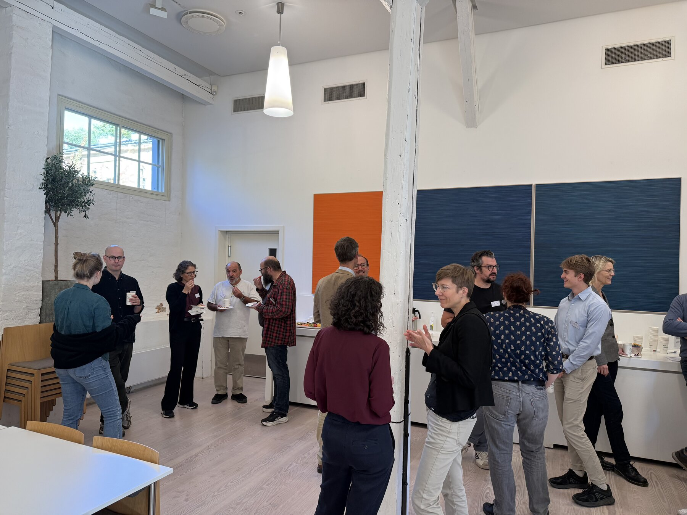
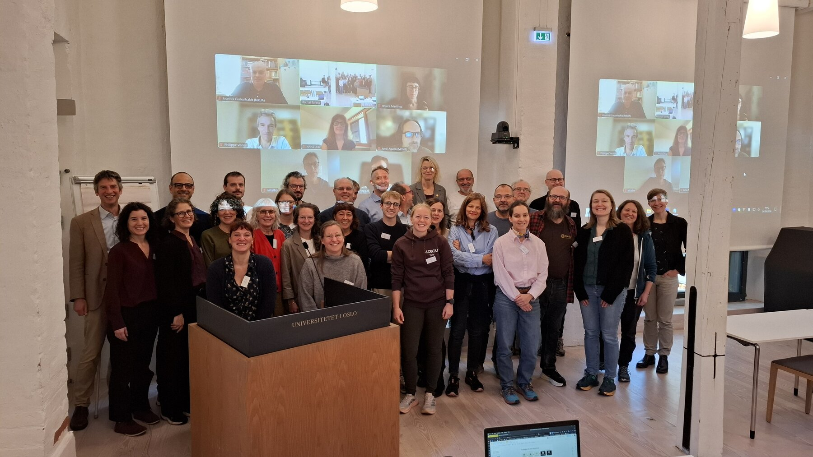
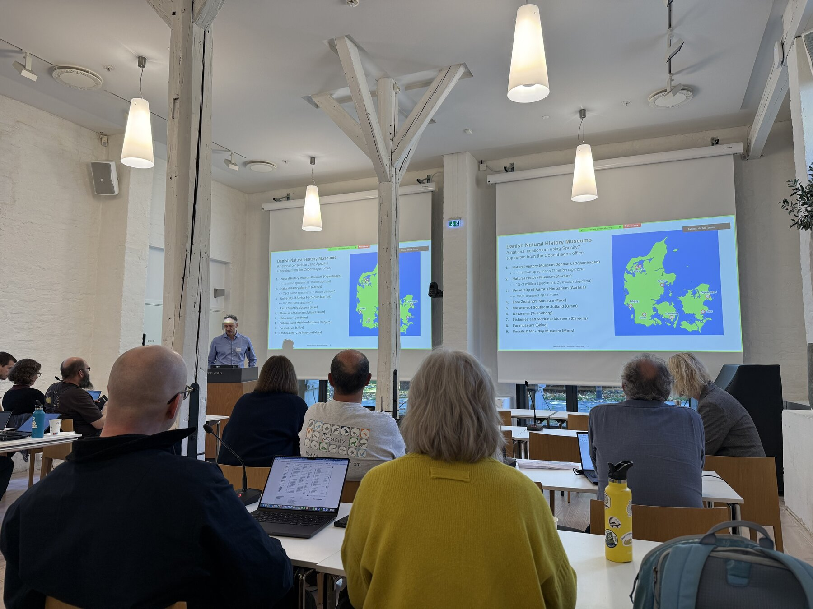
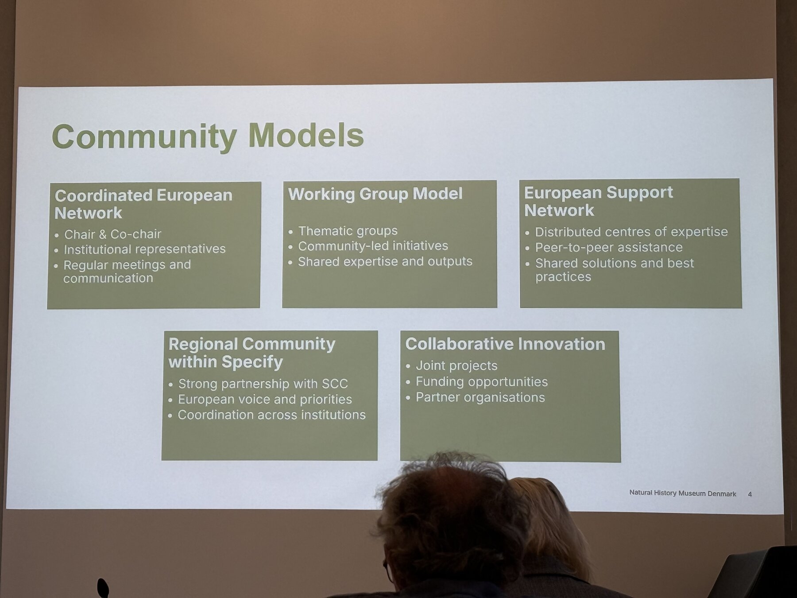
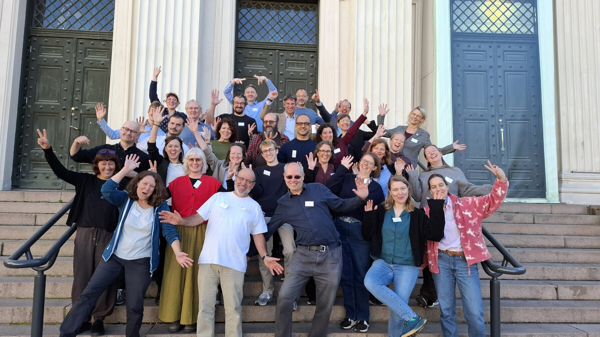

The final event of my September trip began the morning after TDWG ended. On September 26, I walked back to the University of Oslo for the first European Specify Summit.

By this point, the trip had included [SPNHC in Cape Town](/blog/spnhc-2026/), three days of [workshops in Oslo](/blog/oslo-workshop-2026/), and a full week at [TDWG](/blog/tdwg-2026/). The summit gave us time to bring some of those conversations together and consider what should happen next.

## Building a European community

The [European Specify Summit](https://natur.unimus.no/events/europeansummit.html) took place on September 26–27 at Professorboligen, part of the University of Oslo. Its purpose was to establish a European Specify community and discuss shared priorities, governance, and ways of working together. The [program](https://natur.unimus.no/events/Summit%20program%20for%20webpage.pdf) made room for talks and discussion across both days.

That felt like a useful way to finish the month. Workshops help people learn the software, and conferences let them share what they are doing. A meeting like this gives the community time to decide how to support that work between events.

The setting was quite different from the conference auditorium. People sat around tables with laptops open, with presentations projected at the front of a bright room. The meeting was both people sharing ideas with the whole room and smaller conversations (breakout groups) taking place between those presentations.

Attendees, both virtual and in person:

People joined both in person and online. Bringing those groups into the same conversation matters for a community spread across institutions and countries. The group photo includes the people on the screen as well as those in the room, which I particularly like.

## What comes next

The summit produced an action plan for the following ten months, including steps toward establishing Specify Europe as a European Advisory Group within the Specify Collections Consortium. That is a process to work through together, with the goal of strengthening European users' involvement and representation.

The agreed priorities included closer collaboration with European collections initiatives, identifying training needs, and understanding requirements particular to institutions in Europe. There is useful work to do in each area: making connections between workflows and data pipelines, finding out which workshops people need, and bringing regional requirements into the consortium's discussions.

The maps in the presentations helped make the reach of the community visible. Institutions may be separated by borders and languages while still working through similar questions about migration, system configuration, and data quality. Knowing who else has experience with a problem can be a useful starting point for working through it.

The outcomes report identified collaboration with CETAF and DiSSCo as one area for follow-up. It also called for a clearer picture of European training needs and the regional requirements that collections software should address. These give future meetings specific subjects to work on, while leaving room for institutions to explain what matters most in their own settings.

I was glad to see training and knowledge exchange among those priorities. After spending three days teaching earlier in the trip, it was good to consider how future learning opportunities could be shaped by the people who would use them. The community already holds a great deal of experience; making it easier to share that experience is valuable in its own right.

A regional group also needs a way to organize itself. How do people bring forward a shared concern? Which subjects need a working group, and which would benefit from a workshop? How can the group stay useful to people with different levels of technical experience? The discussion of community models gave those questions a place in the meeting alongside the technical presentations.

Theresa Miller and Fedor Steeman will coordinate follow-up meetings. Having people help carry the agreed work forward gives the conversations somewhere to go after everyone returns home.

## One last group photo

There was, of course, a formal group photograph. There was also this one.

On Sunday, I also walked to another part of campus for a separate [DwC-DACK meeting](https://www.gbif.org/project/CESP2026-014/dwc-dack-darwin-core-data-package-adoption-capacity-enhancement-and-knowledge-transfer). Monday gave Aimee and me time to discuss the conferences before the journey home.

## Back to Kansas

I left Oslo early on September 29, taking the train to the airport before flying through London and Dallas to Kansas City. My dad met me at the airport, just as he had helped get me there at the beginning of the trip.

The route home involved three flights and most of a day in transit. After nearly a month of hotels, conference rooms, and working from a suitcase, arriving back in Kansas City that evening marked a very definite change of pace. There was also plenty to take home from the trip: teaching experience from the workshop, examples from the conferences, and a set of next steps from the summit.

It was a long month, and I was ready to be home. I was also grateful for the time people had spent hosting us, teaching, presenting, asking questions, and working through problems together. Thank you to our Oslo hosts and everyone who joined the summit, in person or online. I look forward to seeing where the next conversations take us.
