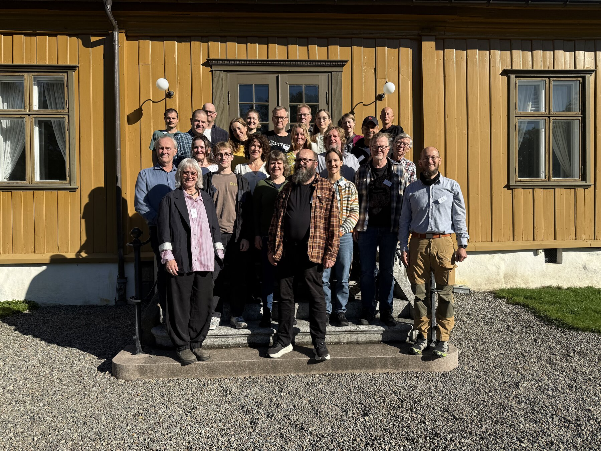
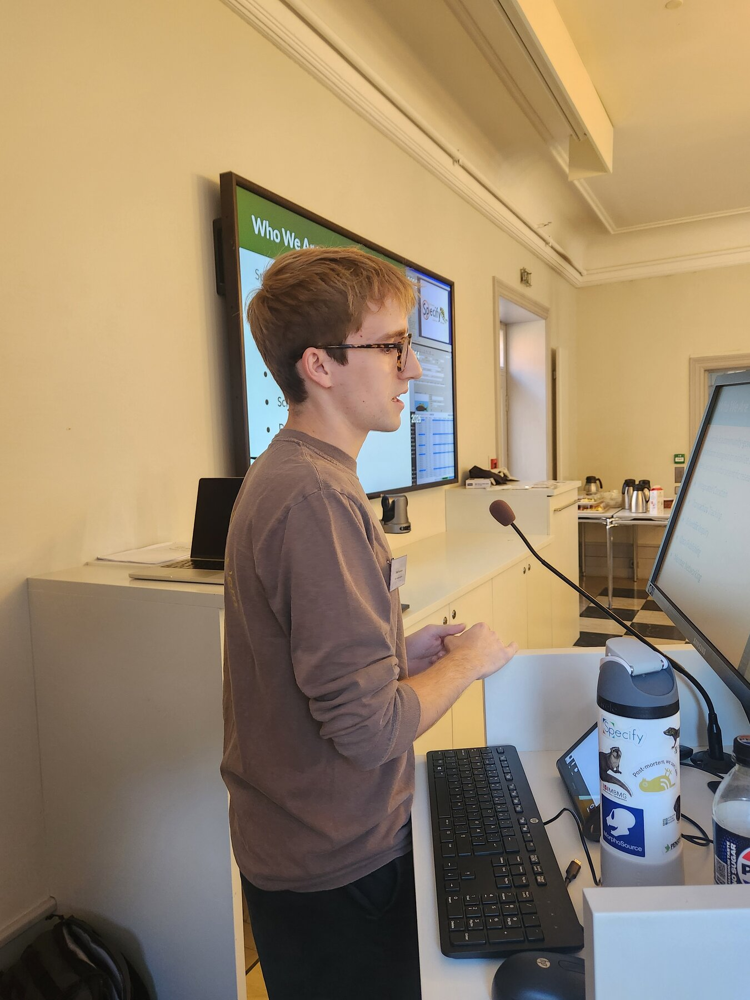
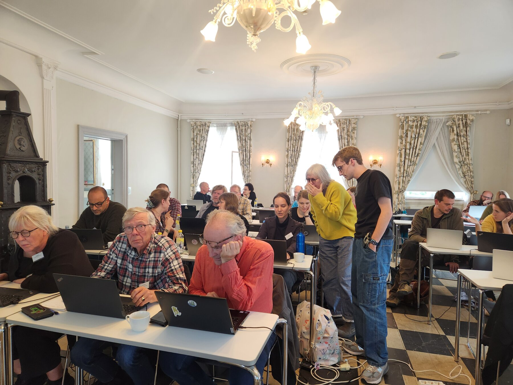
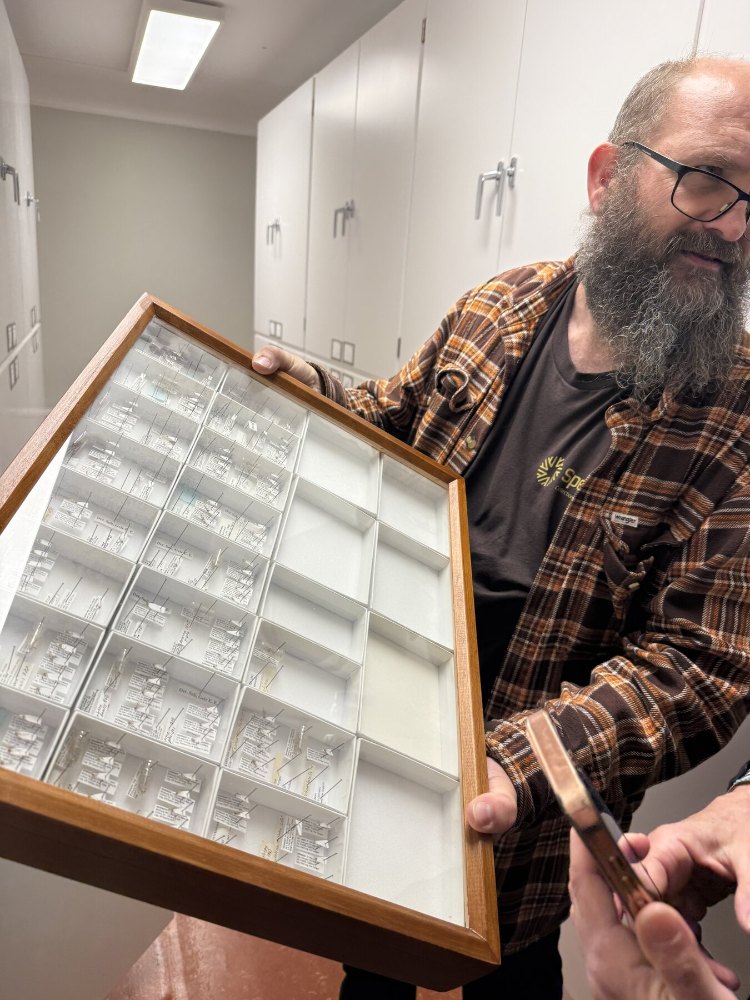
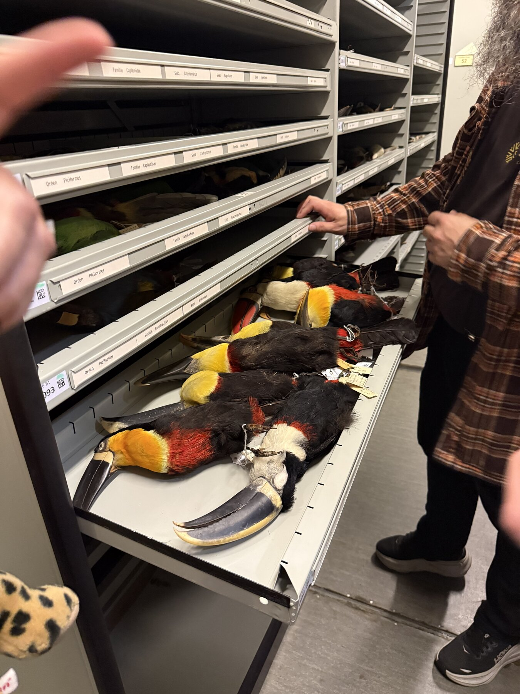
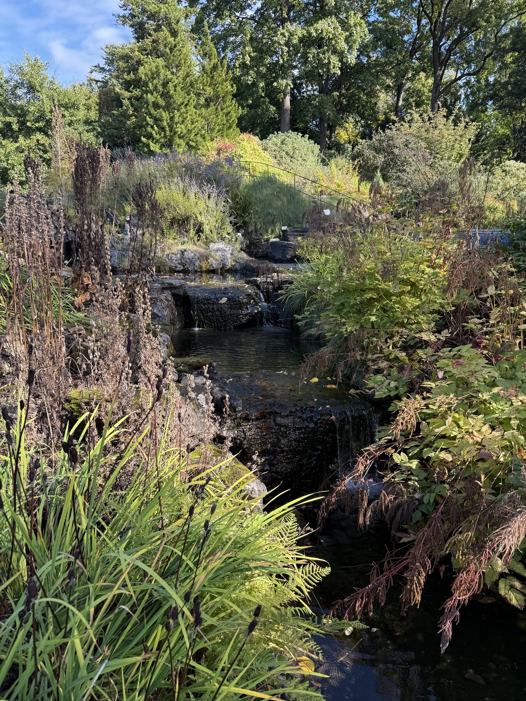
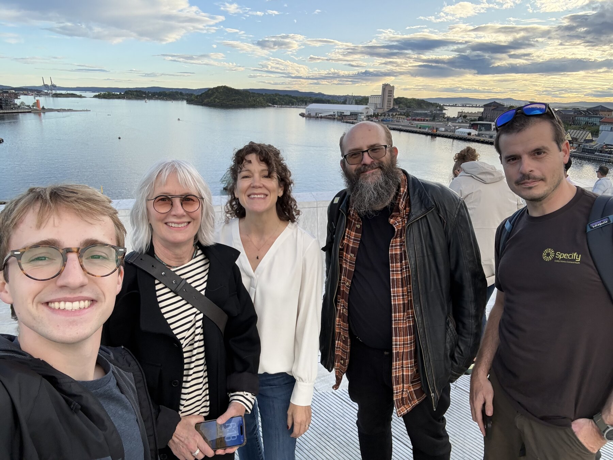

I arrived in Oslo on September 14 after flying from Cape Town through London. The previous week had been [SPNHC in South Africa](/blog/spnhc-2026/), and the next two weeks would include a workshop, TDWG, and the first European Specify Summit. Oslo was going to be home for a while.

I took the train from the airport and settled into the hotel. The next morning, I walked to the University of Oslo to work with our UniMus:Natur colleagues before the workshop began.

## Getting ready together

On September 15, I spent the day with Eirik Rindal and Michal Torma discussing logistics and technical questions around the move to Specify. Having that time together before teaching began helped connect the workshop to the work the team was already doing.

A collections database carries years of decisions about how to describe specimens, organize information, and support research. Moving to a new system means understanding those decisions and helping the people who rely on them find their way around. That is a large part of what makes this work interesting to me.

## The workshop

From September 16–18, I hosted the workshop at the University of Oslo, with sessions running from 9 to 5 each day.

The room had tall windows, chandeliers, and a black-and-white tiled floor. Then there were the laptops, power cables, and people working through a collections management system together. It was a memorable setting for a technical workshop.

Three full days give people time to become more comfortable with a system and to connect it to their own work. I enjoy that part of teaching: explaining how something works, then making room for the questions that arise when someone tries it themselves. A demonstration only takes you so far. The useful conversations often begin at a participant's laptop.

Workshops also give me a different perspective on the software. When I use Specify every day, it is easy to become familiar with the route through a task. Teaching requires slowing down and making that route understandable to someone else. It is a useful reminder of how much good documentation, clear terminology, and patient support matter.

There is a lot to fit into a full day of teaching, but I try to remember what it feels like to be on the other side of the room. Someone learning a new system is keeping track of the screen, the explanation, and how both relate to their own collection. Time to practice and ask a follow-up question is part of the work. Having several days together gives those conversations space to develop.

## From the screen to the collections

The photographs from this part of the trip also include time with specimens and collection storage. After talking about how information is organized in a database, it is useful to look at the objects that information describes.

Eirik sharing some of his favorite fungus nats:

A tray, a drawer, and the labels attached to specimens can tell you a great deal about how a collection is used. On a screen, it is easy to think in terms of fields and records. In a collection room, those records have a physical setting: objects that need to be found, handled, studied, and returned to the right place. I like having both perspectives close together when working on collections software.

Thank you to the UniMus:Natur team and everyone who took part for making time for three days of learning together, and for the work that went into hosting us.

## Settling into Oslo

My days developed a straightforward routine: walk to the university, spend the day at the workshop, then walk to dinner and back to the hotel. After the complicated journey to South Africa, I appreciated being able to get around on foot.

The camera roll from the week has a good mixture of workshop tables, collections, gardens, and time outside with colleagues. I particularly like the waterfront photographs. They capture another side of a work trip: getting to spend time with people away from the tasks that brought everyone together.

Staying in one city for two weeks also gave the trip a different rhythm from a short conference visit. I could settle into the walks between the hotel and our meeting places, then change destinations as one event gave way to the next. By the time TDWG began, Oslo felt a little more familiar.

There were two quieter days after the workshop before the next event began. With another full week of presentations ahead, a little time to rest was welcome.

The workshop was the most concentrated stretch of teaching on this trip. The following week would widen the conversation from working with collections data to sharing it across institutions and systems at [TDWG 2026](/blog/tdwg-2026/).
