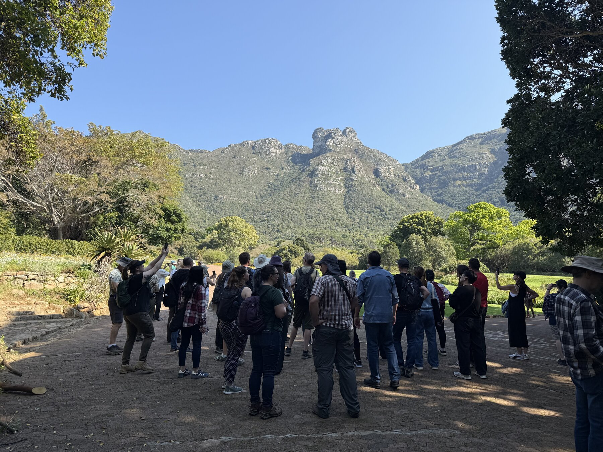
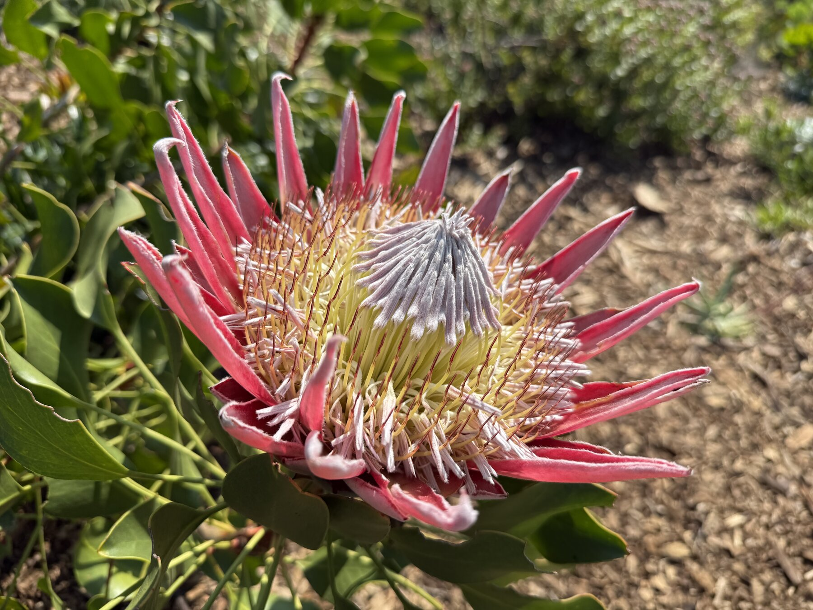
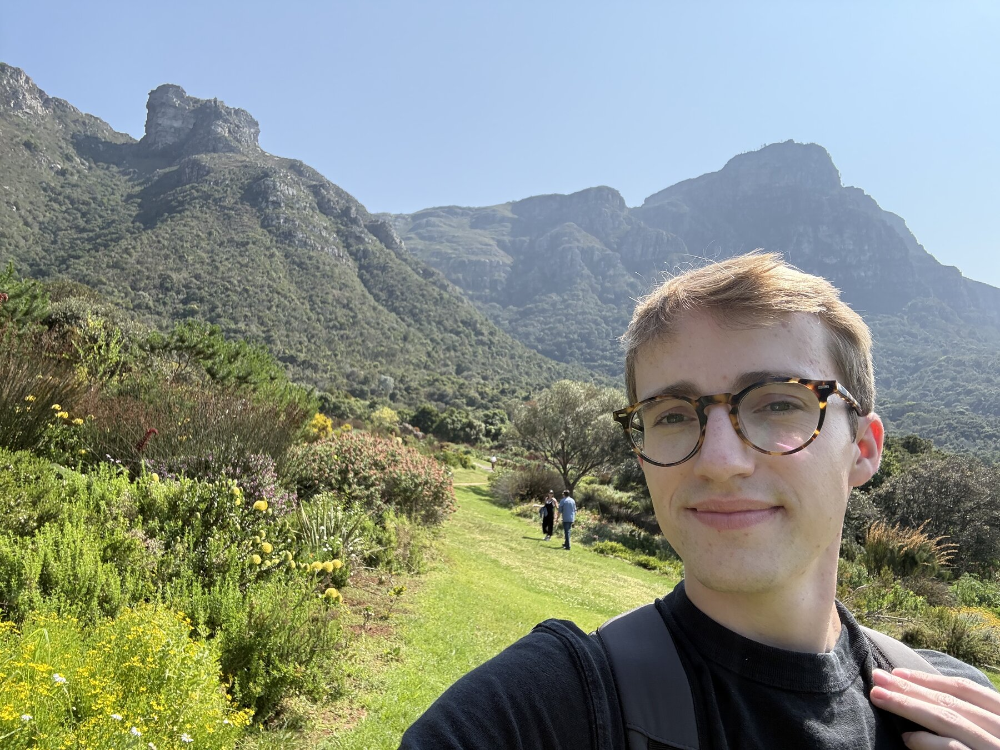
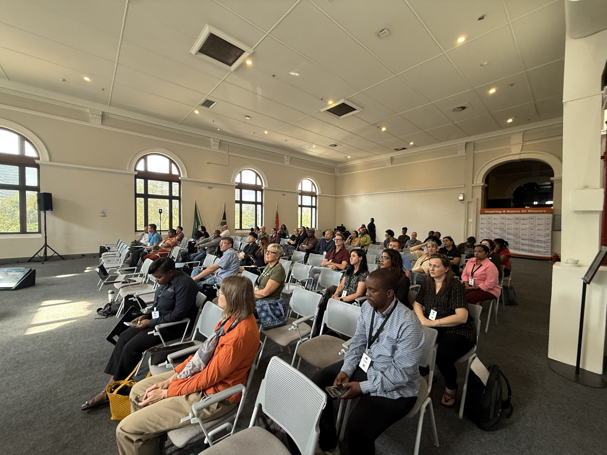
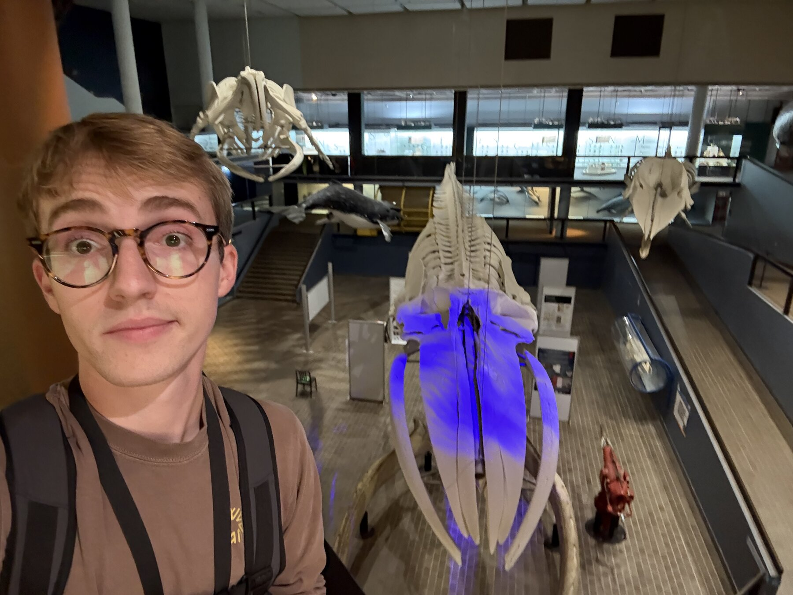
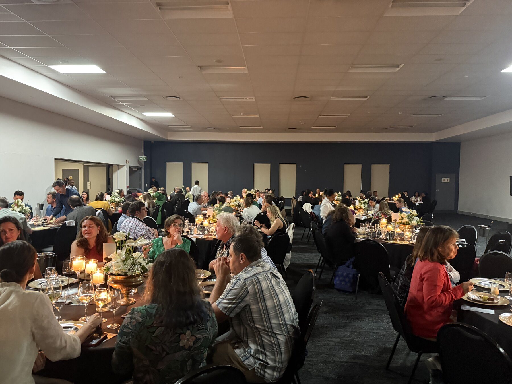
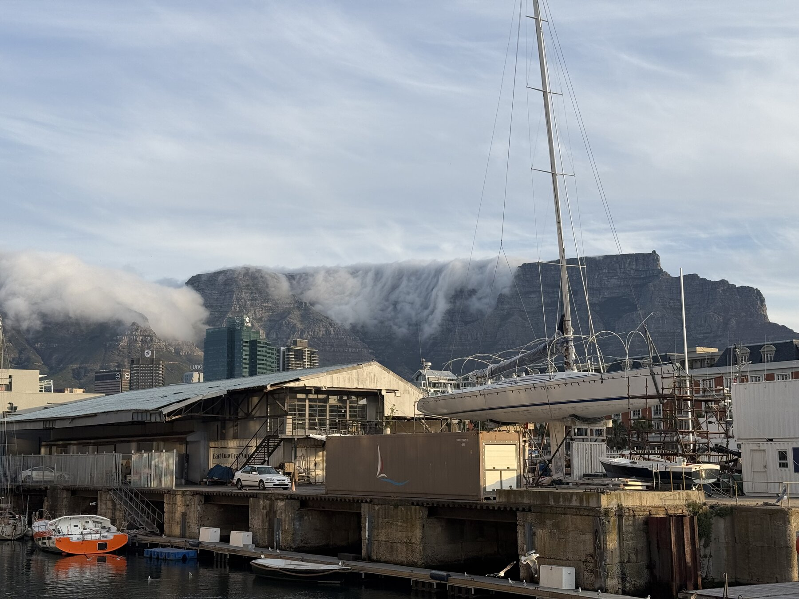
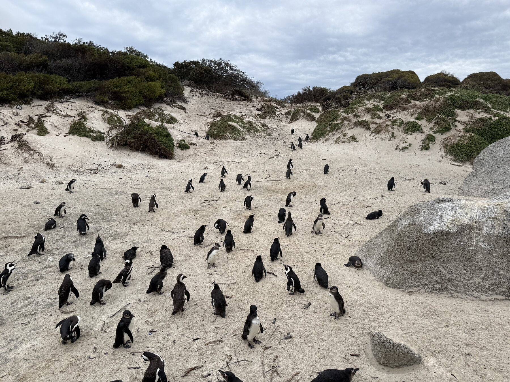

Getting to Cape Town took a little more persistence than I had planned.

I left Kansas City on September 4 expecting a long journey. What I got was an extra night near Dulles, a rescheduled departure, a diversion to Newark for a passenger's medical emergency, and another departure in the early hours of the morning. By the time I reached my hotel in Cape Town, it was after midnight on September 7. My suitcase was still making its own arrangements.

This was the beginning of almost a month away from home, with four events across South Africa and Norway. Fortunately, the first morning in Cape Town offered a very good reason to get out of bed.

## Kirstenbosch

I joined the SPNHC group at the Iziko South African Museum for the bus to Kirstenbosch. After so much time in airports, walking outside with mountains above us and plants all around was a welcome change of pace.

There is something particularly enjoyable about visiting a garden with people who work with natural history collections. The plants are the reason to stop, and the people around you are another reason to stay. It was a lovely introduction to the week ahead, before the conference sessions and the icebreaker brought everyone together.

The scale of the landscape was difficult to fit into a photograph. I could point the camera at a single flower, then look up and have an entire mountainside in front of me. After spending the preceding days following departure boards, it was a relief to have something else to look at.

We returned to the Iziko museum by bus. The trip had started late, but I was finally where I was supposed to be, with a week of collections conversations ahead of me.

## Work

SPNHC took place at the Iziko South African Museum, which I could reach on foot from my hotel. The week included plenaries, presentations, collection tours, workshops, and plenty of opportunities to talk between sessions.

On September 9, I presented **[Supporting Collaboration with Specify 7](https://virtual.oxfordabstracts.com/event/76295/submission/117)**, coauthored with Theresa Miller, in the Specify Spotlight session, *Data Digitization and Management in South Africa and Beyond*.

The session brought together examples from South African collections: small mammals at Ditsong, the Shortridge mammal collection at Amathole, workflows across the KwaZulu-Natal Museum's collections, and biodiversity biobanking at SANBI. These are the kinds of presentations I value most at a meeting like this. They put the software in context: the specimens, the people caring for them, and the practical work involved in making their information accessible.

One theme running through the Spotlight session was access. Digitizing a collection creates opportunities for people who cannot travel to the museum to discover and use its holdings. But the people doing that digitization still have to work within the time, staffing, and resources available to them. Hearing examples from several institutions in the same session made those practical considerations much more visible.

The range of collections was useful, too. A biobank and a mammal collection may use some of the same software tools, but they bring different specimens, histories, and questions to the database. Listening to those differences helps me think more carefully about what we ask the software to do.

I also presented **Specify Collections Consortium: Transiting to Sustainability** during the conference. The broader conversation about sustaining collections infrastructure was relevant to my work as well. The session *Sustaining collaborative collections infrastructure in uncertain times* asked how our community can maintain software, data, expertise, and training beyond individual projects. Those questions follow us home from conferences. A useful system needs people who understand it, documentation that keeps up, and a community willing to share what it learns.

## Between sessions

Being based at a museum added another dimension to the conference. In between discussing digital records and workflows, there were physical collections and exhibits close at hand. My camera roll includes this stop with a **very** blue whale.

The week also included the Grill & Greet braai and the gala dinner. Having time together outside a presentation room is a large part of why these trips matter to me. A full conference schedule leaves plenty to discuss over dinner.

My suitcase finally reached Cape Town during the conference. Getting it back involved another trip to the airport on September 9, which was a less exciting addition to the itinerary. At least we were finally in the same city.

Cape Town provided much better subjects for photographs than baggage collection. Mountains, gardens, and penguins made it into the camera roll.

The waterfront offered a different view of the mountains, with clouds hanging over the ridge and boats in the foreground. Looking back through the photographs, I appreciate how much of the setting made it into the trip despite the busy schedule. The museum, the garden, and the coast each gave me a different way to experience the place we had all traveled to.

Also, African penguins!

On September 13, I left for Oslo via London. I was grateful to everyone who made the SPNHC week possible, and to the colleagues who shared their collections and experiences with us. The next stop was three days of teaching at the [UniMus:Natur workshop in Oslo](/blog/oslo-workshop-2026/).
