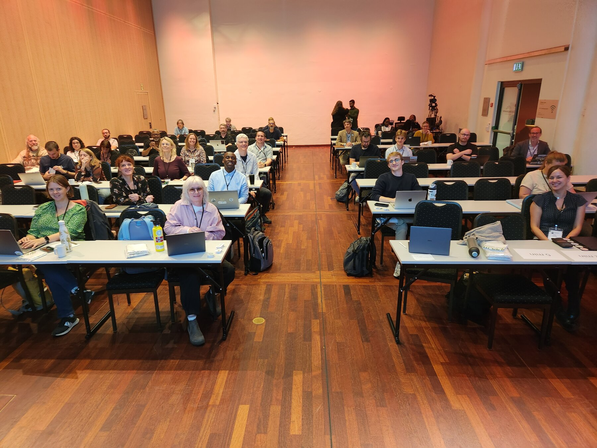
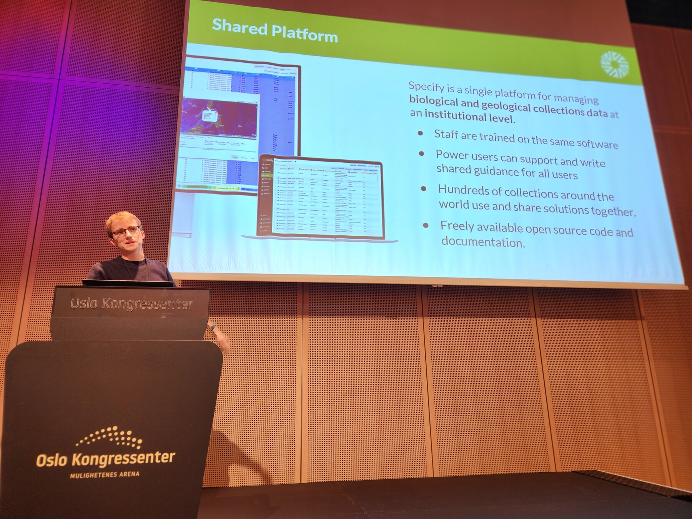
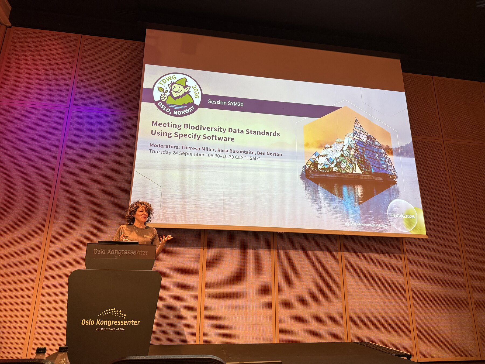
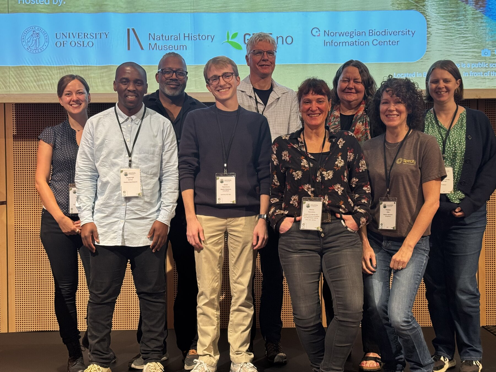

By the start of TDWG, I had been in Oslo for a week. The [UniMus:Natur workshop](/blog/oslo-workshop-2026/) had finished, I had a couple of days to recover, and my morning walk now led to the Oslo Congress Centre.

TDWG ran from September 21–25. It was a chance to step back from the day-to-day work of a particular database and spend time with the wider community working on biodiversity data standards.

That subject can sound abstract until you try to share a collection's data. A field that makes perfect sense to one institution needs to be understandable elsewhere. Names, relationships, and formats all become part of the conversation. For those of us working on collections software, these questions turn into very practical decisions about what people enter and what they can publish.

## Meeting biodiversity standards with Specify

On September 24, I presented **Meeting Biodiversity Standards with Specify 7** as part of the symposium *Meeting Biodiversity Data Standards Using Specify Software*. Theresa Miller, Rasa Bukontaite, and Ben Norton moderated the session.

The symposium ran from 8:30 to 10:30, with my talk near the end of the morning's sequence. That meant placing our software work alongside the experiences of the people using it. It was a useful setting for a presentation about standards: the rest of the session showed the variety of collections and workflows those standards need to support.

My presentation covered work toward integrating Darwin Core standards more closely into Specify's data model. The aim was to make standards easier to meet during data entry and to support publishing to services such as GBIF, ALA, GGBN, and iDigBio, while retaining the flexibility collections need. These were developments we were working toward at the time of the conference.

For me, the practical question is how to make good data management easier for the person doing the work. Collections staff have to record information accurately, find it again, and share it in a form other people can use. Software has an important role in helping those steps fit together.

A useful way to think about the challenge is to follow a record from entry to publication. The person entering it needs fields that match the information they have. The institution needs to preserve the detail that matters to its collection. Someone receiving the published data needs to understand what the values mean. Decisions made early in that process affect how much interpretation and cleanup will be needed later.

That is why I am interested in bringing standards closer to everyday data entry. There is an opportunity to make publishing less burdensome when the underlying information is already organized with sharing in mind.

## Hearing from the collections

The symposium included ten presentations, with examples of Specify in use across different collections and research settings. Topics ranged from ephemeral research repositories and botanical data standards to biobanking, legacy collections, and publishing workflows.

The program included Robyn Drinkwater on standards at the Royal Botanic Garden Edinburgh, Siyabonga Zamisa on moving from legacy data to FAIR workflows, Kim Labuschagne on biodiversity biobanking, and Marion Depraetere on the Museum für Naturkunde Berlin's collections. Dan Baker and Samanta Orellana contributed virtual presentations on workflows at CSIRO and data mobilization in the KU Entomology Collection.

Kevin Holston's contribution addressed ephemeral repositories in collections-based research, while Niels Klazenga spoke about integrating Specify into broader science infrastructure. Together, the program moved between the immediate work of managing a collection and the larger systems that its data becomes part of.

Seeing these subjects together helps explain why a collections platform needs both shared conventions and room for local practice. Different institutions bring different histories and responsibilities to the same tools. I appreciate the time people put into explaining their work to the rest of us; those examples are valuable long after a session ends.

## A little Oslo between conference days

On the first day, I joined other TDWG attendees for a tour of Oslo City Hall. It was a welcome opportunity to see more of the city with the conference group.

On September 23, I took transit to Vigeland with Eirik Rindal, Michal Torma, and Gunnhild Marthinsen. We talked about our ongoing work while spending some time away from the conference venue. The rest of the week largely followed the familiar rhythm of walking to the Congress Centre, attending sessions, and walking back after dinner.

Those changes of setting helped break up a week spent largely indoors. City Hall was a chance to see Oslo with other attendees, while the outing to Vigeland gave us a different setting for conversation with our hosts. After several days of slides and session schedules, I appreciated having some time to walk and talk.

Friday brought TDWG to a close, but there was one more event before heading home. On Saturday, we returned to the University of Oslo for the [first European Specify Summit](/blog/european-specify-summit-2026/), where the focus would turn to how this community could keep working together.
